# 架构设计（dashboard-rs）

本文是 dashboard-rs 的整体架构文档：系统上下文、组件与线程模型、模块依赖、核心流程、
数据契约、关键设计决策与扩展方案。全部图示为 Mermaid，GitHub/IDE 可直接渲染。
使用说明见 [USAGE.md](../USAGE.md)，开发速查见 [DEVELOPMENT.md](./DEVELOPMENT.md)。

---

## 1. 系统定位与上下文

一句话：**桌面电脑上的一个托盘常驻程序，周期性地把「天气 + RSS + 待办 + 倒数日 +
农历」等信息渲染成一张 Kindle 墨水屏尺寸的灰度 PNG，Kindle 屏保通过局域网 HTTP
拉取显示（可选 SSH 主动推送触发）。**

系统只有两个"端"：桌面服务进程（本仓库）与 Kindle 墨水屏（`kindle-fixes/` 提供的
online_screensaver / KOReader 配置）。桌面进程对外是「数据的消费者」（抓公网 API）
+「图片的提供者」（HTTP 供图）双重身份。

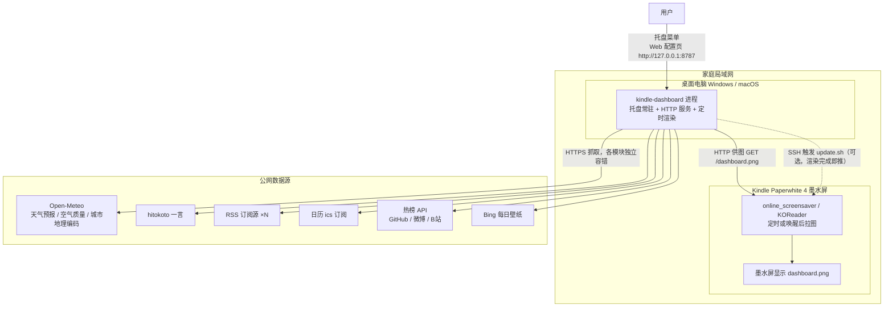

**三种运行模式**（同一二进制，按子命令区分）：

| 模式 | 命令 | 主线程去向 | 场景 |
|---|---|---|---|
| 托盘常驻（默认） | 无参数 / 双击 exe | winit 托盘事件循环 | 日常使用 |
| 前台服务 | `serve` | `park()` 挂起等 Ctrl+C | 终端/脚本跑，日志直出 |
| 单次渲染 | `once` | 渲染一次即退出（0/1） | 改模板/配置后验证 |

---

## 2. 总体架构（组件视图）

进程内是「一主三辅」四个执行流：主线程（托盘事件循环）、HTTP 线程（tiny_http 串行
accept）、渲染线程（周期渲染 + 信号唤醒）、推送线程（按需创建，渲染成功后触发）。
线程间通过一个 `Arc<Shared>` 状态块 + 一条 mpsc 通道协作，全部共享量都加了锁，
没有跨线程的裸引用。

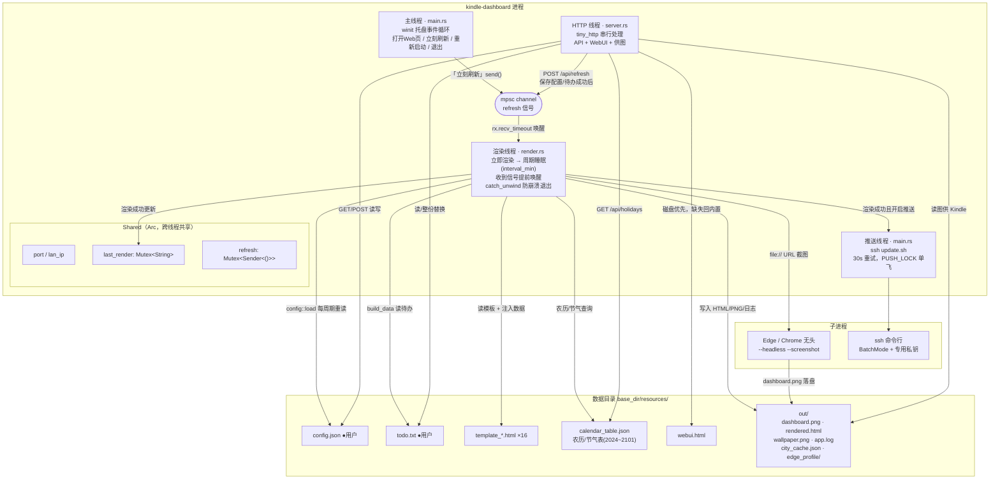

●用户 = 升级时永不覆盖的文件（详见 §8）。

### 职责一览

| 组件 | 代码 | 职责 | 不负责 |
|---|---|---|---|
| 入口/编排 | `main.rs` | 模式分发、资源释放与升级、线程编排、托盘 UI、SSH 推送、日志 `log_line`、数据目录定位 | 业务与渲染细节 |
| HTTP 服务 | `server.rs` | 全部路由（API/WebUI/供图）、`Shared` 状态定义、请求校验、静态文件白名单 | 主动渲染（只发信号） |
| 渲染 | `render.rs` | 模板扫描/白名单、数据注入、无头截图、灰度化 | 抓数据（委托 data） |
| 数据 | `data.rs` | HTTP 客户端、天气/空气/一言/RSS/待办/倒数日、组装模板 JSON | 模板与展示 |
| 扩展数据 | `extras.rs` | ics 日程、热榜聚合、Bing 壁纸（裁切 + Floyd–Steinberg 抖动 1-bit） | 核心字段 |
| 农历 | `lunar.rs` | 查表得农历/节气/月相、节假日兜底 | 联网（纯离线） |
| 配置 | `config.rs` | 字段级容错读取 + 默认值 | 写入（写由 server 做） |

---

## 3. 模块关系（src/ 依赖图）

分层清晰，自底向上：**基础层（config/lunar）→ 数据层（data/extras）→ 渲染层
（render）→ 接口层（server）→ 编排层（main）**。

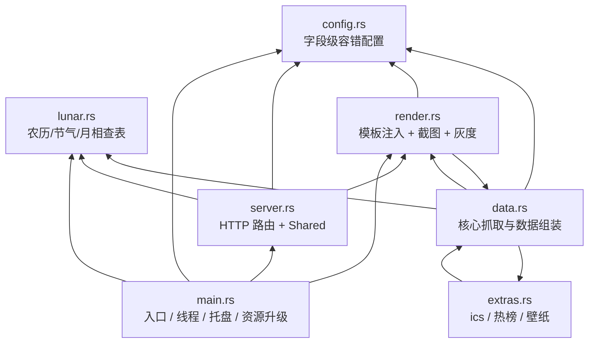

两处**局部互调**（均为单项函数借用，无初始化顺序问题，读代码时不要误以为是循环依赖）：

- `data ⇄ extras`：`data` 调 `extras::{fetch_schedule, fetch_hotlist, fetch_wallpaper}`；
  `extras` 只借用 `data::http_get`。
- `data → render`：仅借 `render::dimensions()`（壁纸按屏尺寸裁切）；`render` 调
  `data::build_data`。

另有一个"反向"依赖：`log_line` 定义在 `main.rs`，`data`/`render` 通过
`crate::log_line` 调用（stderr + `out/app.log` 双写）。

**外部依赖刻意少**：`tiny_http`（HTTP）、`reqwest`（抓取）、`image`（灰度/壁纸）、
`tray-icon` + `winit`（托盘）、`chrono`、`serde_json`、`feed-rs`（RSS 解析）、
`socket2`（SO_REUSEADDR）。TLS 按平台拆分：Windows 走 schannel（交叉编译免 C 工具链），
macOS/Linux 走 rustls。

---

## 4. 线程与并发模型

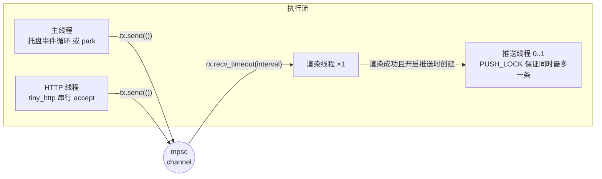

| 同步点 | 机制 | 说明 |
|---|---|---|
| 渲染唤醒 | `mpsc::channel<()>` + `recv_timeout` | 定时到或收到信号都 break 出内层循环去渲染；通道断开则线程退出 |
| 共享状态 | `Arc<Shared>`，字段各自 `Mutex` | `last_render`（状态页展示）、`refresh`（Sender 装进 Mutex 以便多线程发送） |
| 推送单飞 | `OnceLock<Mutex<()>>` + `try_lock` | 同一时刻只有一条 SSH 重试链，后续渲染触发直接跳过 |
| 端口占用 | `socket2` 手动建 listener + `SO_REUSEADDR` | 避免重启被 TIME_WAIT 卡 30s~2min；托盘模式占用时弹系统对话框 |
| 渲染崩溃 | `catch_unwind(AssertUnwindSafe)` | 渲染线程内部 panic 只记日志，下个周期重试，服务不退 |

线程崩溃面收敛在渲染线程一处（截图/解析最不可控），HTTP 与主线程不执行抓取逻辑。

---

## 5. 核心流程

### 5.1 启动流程

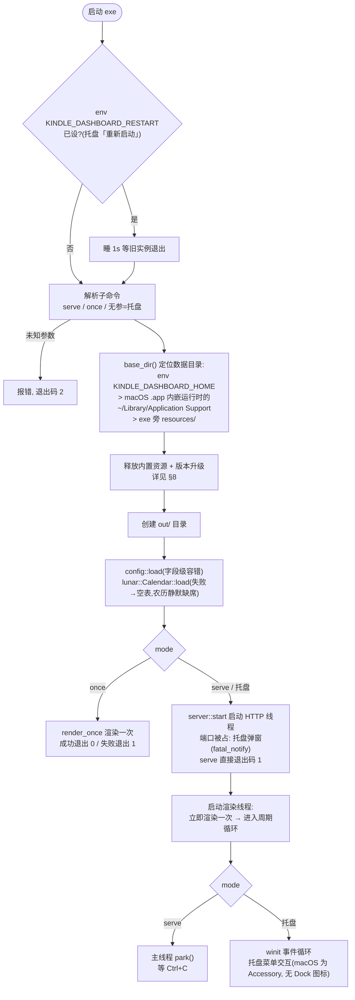

要点：**配置与农历表在启动时只加载一次句柄，但配置内容每个渲染周期重读**——
Web 页改配置立即生效，无需重启；农历表缺失只降级不致命。

### 5.2 渲染管线（主流程）

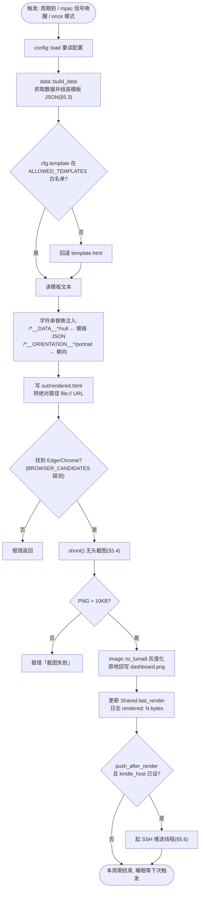

截图尺寸随朝向：竖版 **1072×1448**，横版 **1448×1072**（PW4 面板像素）。

### 5.3 数据组装 `build_data`（模块开关与容错）

设计原则：**每个数据模块独立容错，单项失败只影响自己的字段**（记 `weather_error`
或留空），模板对 null/error 字段降级显示，整页永不空白。

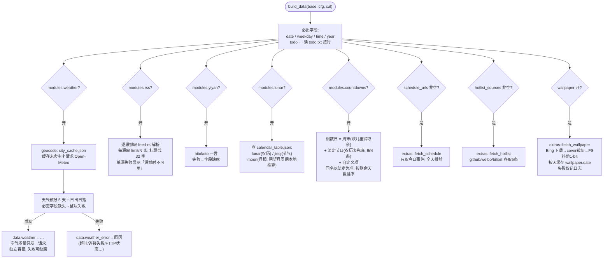

模板 JSON（`__DATA__`）最终结构：

| 字段 | 类型 | 说明 |
|---|---|---|
| `date` `weekday` `time` `year` | string/int | 本地日期(`M月D日`不补零)/星期/`HH:MM`/年份 |
| `todo` | string[] | 待办非空行 |
| `weather` | object\|null | `city/temp/code/wc/wind/days[5]/sunrise/sunset`，可带 `aqi/aqi_desc/pm25` |
| `weather_error` | string? | 仅天气失败时存在 |
| `rss` | {src,title}[] | 每条含来源名 |
| `yiyan` | {text,from,who}? | 一言 |
| `lunar` / `jieqi` | string? | 农历文案 / 节气展示 |
| `moon` | {name,illum} | 月相名 + 照明率 |
| `countdowns` | {name,days,date,holiday?}[] | 已排序 |
| `schedule` | {title,all_day,time}[]? | 今日日程 |
| `hotlist` | {src,items[{title,hot}]}[]? | 热榜 |
| `wallpaper` | {file,credit}? | 相框模板用，图片在 `out/wallpaper.png` |

### 5.4 截图完成判定 `shoot()`

无头浏览器截图没有可靠的"完成回调"，采用的策略是**轮询 PNG 落盘尺寸稳定**：

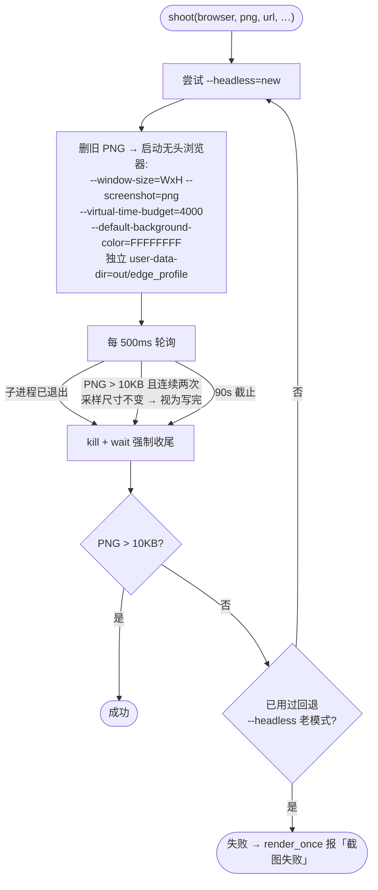

### 5.5 Web 配置保存 → 上屏（端到端时序）

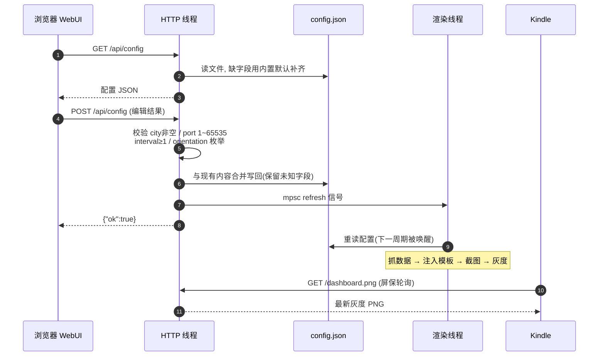

「保存即上屏」由 HTTP 线程直接发 refresh 信号实现，等待时间 = 一个渲染周期
（秒级），Kindle 侧最长再等一个屏保轮询间隔。

### 5.6 SSH 主动推送（可选加速）

Kindle 屏保是定时轮询拉图；若希望"渲染完成即上屏"，渲染线程成功后追加一步 SSH
触发 Kindle 端 `update.sh`（默认经 KOReader screensaver 的口令，端口 2222）：

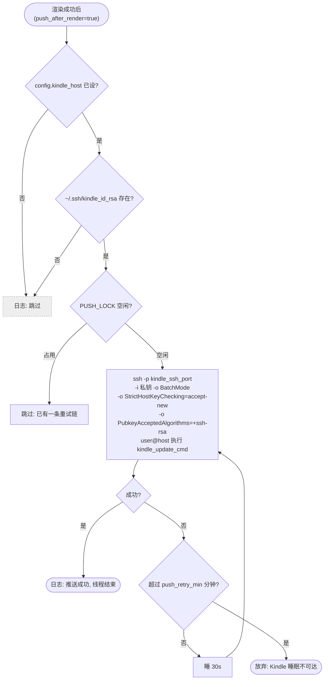

失败重试专为"Kindle 在睡眠"设计：渲染后立即推，设备醒来的窗口期内补上。

### 5.7 Kindle 拉图（被动通道）

`server.rs` 对 `GET /dashboard.png` 无任何特殊处理——它就是"静态文件只允许
`out/` 下 `png/html/json` 三类扩展名"这条白名单规则的普通命中。Kindle 端
（`kindle-fixes/`）的 online_screensaver 按自身节律向
`http://{lan_ip}:{port}/dashboard.png` 发起拉取；`lan_ip` 用
**UDP connect 探测**（朝 `kindle_host:2222` 或 `223.5.5.5:80` 连一次，读本地地址），
保证多网卡机器返回 Kindle 所在网段的 IP。

---

## 6. HTTP 接口与静态资源

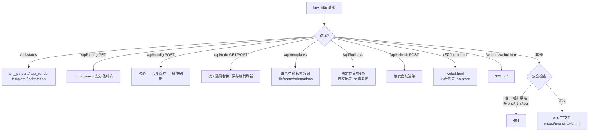

错误契约统一：`{"ok": false, "error": "…"}` + HTTP 400。完整字段说明见
[DEVELOPMENT.md](./DEVELOPMENT.md#http-api-契约)。WebUI（`resources/webui.html`）
是单文件原生 HTML+JS，与 API 的约定是"GET /api/config 返回的字段必然齐全"
（由服务端默认值补齐保证）。

---

## 7. 数据目录布局

`base_dir()` 解析优先级：`KINDLE_DASHBOARD_HOME` 环境变量 >（macOS `.app` 内嵌运行）
`~/Library/Application Support/KindleDashboard` > exe 旁 `resources/`（Windows 绿色
便携默认）。

| 文件 | 归属 | 说明 |
|---|---|---|
| `config.json` | ●用户数据 | 全部配置；缺字段自动回退默认 |
| `todo.txt` | ●用户数据 | 待办，`todo_file` 可改名 |
| `template_*.html` | 程序文件(可改) | 16 个模板，9 个在白名单内启用 |
| `calendar_table.json` | 程序文件 | `gen_tables.py` 预生成，2024-02 ~ 2101-01 |
| `webui.html` | 程序文件 | 配置页前端 |
| `resources.version` | 运行时 | 升级标记（RESOURCE_VERSION 快照） |
| `city_cache.json` | 运行时 | 城市地理编码缓存 |
| `out/dashboard.png` | 运行时 | 渲染产物（灰度），HTTP 供图对象 |
| `out/rendered.html` | 运行时 | 注入数据后的中间产物（截图输入） |
| `out/wallpaper.png` + `.date` | 运行时 | Bing 壁纸按天缓存 |
| `out/app.log` | 运行时 | 日志（stderr 同步双写） |
| `out/edge_profile/` | 运行时 | 无头浏览器独立 profile（**不在 HTTP 白名单内**） |

---

## 8. 资源嵌入与升级机制

所有默认资源经 `include_str!` 编译进二进制（单文件分发），首次运行释放到数据目录；
升级用 `RESOURCE_VERSION`（当前 "10"）与磁盘上的 `resources.version` 比对驱动：

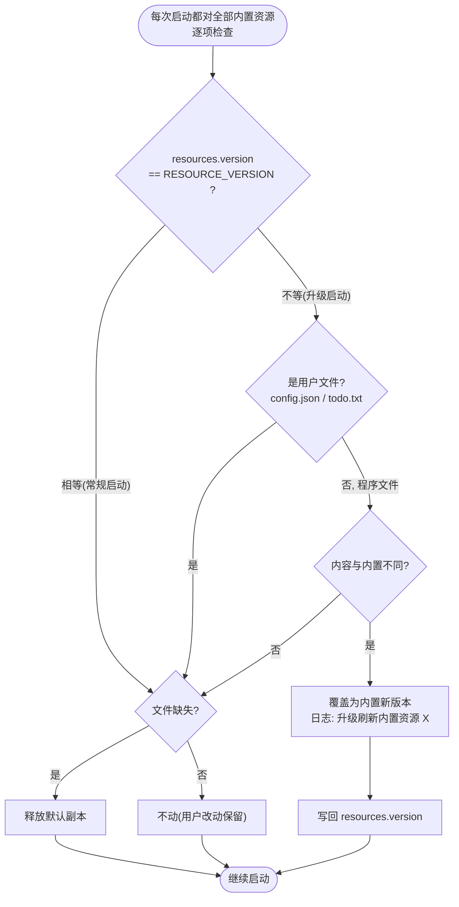

两条铁律：**用户文件只建不盖**（改过的 config/todo 永远安全）；**程序文件升级即刷新**
（改过内置模板的用户需在升级后重新套用改动）。改了 `resources/` 里的内置文件必须
把 `main.rs` 的 `RESOURCE_VERSION` +1，否则已部署机器不会升级。

---

## 9. 关键设计决策（ADR 摘要）

| # | 决策 | 背景 / 动机 | 取舍与后果 |
|---|---|---|---|
| 1 | **无头浏览器截图当渲染引擎** | 想要 HTML/CSS 的全部排版能力而免自研排版库；模板即网页 | 依赖本机 Edge/Chrome；单帧约 1~3s；需 90s 超时兜底与完成判定（决策 5） |
| 2 | **模板 = 纯 HTML+JS，数据经 `/*__DATA__*/null` 字符串替换注入** | 零服务端模板引擎；模板文件可双击离线打开（占位 null）直接调试样式 | 模板消费的是一次性数据快照；循环/条件都在前端 JS 里写 |
| 3 | **数据模块独立容错** | 单一数据源故障不应让整页空白 | 模板必须处理 null/`weather_error`；天气的必需字段缺失仍整块失败，避免渲染残缺数据 |
| 4 | **配置字段级容错 + `warn_once`** | Web 页/手改都可能产生单字段手误 | 坏字段回退默认值并只告警一次；只有整份 JSON 不可解析才整体回退 |
| 5 | **截图完成 = PNG 落盘尺寸稳定（>10KB 且两次采样一致）** | headless 截图无完成回调 | 500ms 轮询，90s 强杀；`--headless=new` 失败自动退 `--headless` |
| 6 | **include_str! 单文件分发 + RESOURCE_VERSION 升级** | 绿色便携、双击即用；用户数据不能被升级覆盖 | 用户文件永不覆盖；改内置文件必须手动升版本号 |
| 7 | **HTTP 拉取为主，SSH 推送为辅** | 屏保轮询天然可靠；推送省电且即时 | 推送 30s 重试 + `push_retry_min` 放弃 + 单飞锁；未配 `kindle_host` 自动整体跳过 |
| 8 | **lan_ip 用 UDP connect 探测** | 多网卡机器固定公网探测地址可能选错网卡 | 优先朝 `kindle_host:2222` 连，取本地地址即 Kindle 同网段 IP |
| 9 | **socket2 手动建 listener + SO_REUSEADDR** | 重启被 TIME_WAIT 卡住数十秒到两分钟 | 与 Python 版 `allow_reuse_address` 行为对齐 |
| 10 | **农历/节气离线预生成表** | 节假日接口不稳定（被 Cloudflare 拦、年份覆盖不全） | `gen_tables.py`(lunar_python) 一次生成到 2101 年，节气精确到分钟；表损坏仅降级不致命 |
| 11 | **TLS 后端按平台拆分**（Windows schannel / 其余 rustls） | Windows 交叉编译（cargo-xwin）不需要构建 C 环 | 两套证书行为有细微差异，均接受系统信任库 |
| 12 | **逐项对齐 Python 版语义** | 本项目是已删除的 Python 版的完全移植 | 银行家舍入(`round_py`)、`%d月%d日`不补零、周末欧几里得取余等均有回归测试锁定 |

---

## 10. 约束与演进方向

当前约束（多为有意为之的单用户取舍）：

- `tiny_http` 单线程串行处理请求：单用户场景无压力，但并发拉图 + 保存配置会短暂排队。
- 抓取在渲染线程内**串行**执行（blocking client），一个刷新周期内数据源越多首帧越慢；
  好在周期默认 10 分钟，抓取耗时只影响当帧时间戳。
- `danger_accept_invalid_certs(true)`：为兼容证书不全的 RSS 源（沿袭 Python 版），
  局域网暴露面仅限 `out/` 白名单文件，风险可控但值得知晓。
- ics 解析为极简实现：不支持 RRULE，TZID 按本地墙钟、`Z` 后缀按 UTC+8 硬编码。
- `--virtual-time-budget=4000`：模板 JS 需在约 4s 虚拟时间内完成渲染，勿引入长轮询。
- 壁纸抖动、灰度均在主进程 CPU 完成，1072×1448 单帧耗时可忽略。

可行的演进方向（按性价比排序）：

1. **抓取并行化 + 失败沿用上次数据**：把 `build_data` 的各模块丢线程池并发，
   失败时读取上一帧数据缓存，消除网络抖动对当帧的影响。
2. **WebUI 状态推送**：`/api/status` 轮询换成 SSE，渲染完成实时刷新预览。
3. **渲染与抓取解耦**：数据缓存成 `data.json`，`once` 模式支持跳过抓取，加快模板调试。
4. **多屏 profile**：config 支持多组 (模板/朝向/端口)，一机供多块墨水屏。

---

## 11. 扩展指南

### 11.1 新增模板

1. `resources/` 放 `template_xx.html`，头部加自描述注释：
   `<!-- kindle-template: name=名称 orientations=portrait,landscape -->`；
2. `render.rs` 的 `ALLOWED_TEMPLATES` 白名单加入文件名（**两处缺一不可**，
   白名单外渲染回退 `template.html` 且 Web 页不显示）；
3. 数据从 `/*__DATA__*/null` 注入点的全局 `__DATA__` 读，处理 null 字段降级；
4. `main.rs` `RESOURCE_VERSION` +1（让已部署机器拿到模板）。

### 11.2 新增数据模块

1. `config.rs`：加字段与默认值（或复用 `modules` 开关，`module_on("xx")` 缺省为 true）；
2. 抓取函数放 `data.rs`（复用 `http_get`），失败返回 `Result` / `Option`，**不 panic**；
3. `build_data` 里按开关注入 `data["xx"]`；
4. 需要消费端默认值补齐的话同步改 `resources/config.json`（升 RESOURCE_VERSION）。

### 11.3 新增热榜源

`extras.rs` 加 `hot_xxx(c) -> Result<Vec<Value>, String>`（条目为 `{title, hot}`），
在 `fetch_hotlist` 的 `match` 加分支，`names::hotlist_name` 加中文名。三处齐活。

### 11.4 新增 API

`server.rs` 请求分发的 `match (method, path)` 加分支；遵守既有契约：JSON 返回、
出错 `{"ok":false,"error":…}` + 400、POST 用 `read_body` 限长（256KB）。

### 11.5 农历表再生成

```bash
python gen_tables.py    # 依赖 lunar_python，输出 resources/calendar_table.json
```

改完同样要升 `RESOURCE_VERSION`。表结构：`epoch`（农历 2024 正月初一的公历日期）+
`months`（每月天数与闰月标记）+ `terms`（公历年 → 节气名: MM-DDTHH:MM）。
